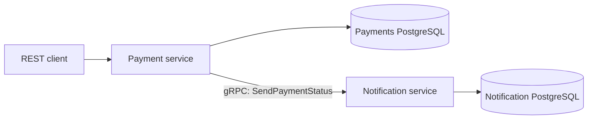

# Go Payment & Notification Services

A hands-on backend and Kubernetes lab built with Go, PostgreSQL, REST, gRPC, Docker, and GitLab CI/CD. The project demonstrates a payment-record API, service-to-service notifications, and container deployment workflows.

This is a portfolio learning project. Provider names in sample records are example data; the application does not charge cards or integrate with live payment providers.

## Architecture



- **Payment service:** create and retrieve payment records through an HTTP API; health and readiness endpoints; a separate WebSocket demo with synthetic currency quotes.
- **Notification service:** receive payment status notifications and retrieve their history through gRPC; persist notifications in PostgreSQL.
- **Infrastructure:** separate Dockerfiles and Compose stacks, Kubernetes manifests with probes and resource settings, and a GitLab pipeline for test, image build, and deployment.

Notification delivery is best effort: the payment is committed first, and a failed gRPC call does not roll it back. There is no durable delivery queue or automatic reconciliation in this version.

## Run locally

Install Docker with Compose. The supplied connection between the two stacks uses `host.docker.internal`, as provided by Docker Desktop. On Linux, configure this hostname or adapt the connection address for your environment.

From the repository root, start the notification stack first:

```bash
docker compose -f notification-service/docker-compose.yml up -d --build
docker compose -f payment-service/docker-compose.yml up -d --build
```

The payment API listens on `localhost:8080`, and the notification gRPC service on `localhost:9090`. PostgreSQL ports are `5432` and `5433`. Inspect Compose logs if a service starts before its database is ready.

```bash
curl http://localhost:8080/health
curl http://localhost:8080/ready
curl http://localhost:8080/payments
curl -X POST http://localhost:8080/payments \
  -H "Content-Type: application/json" \
  -d '{"order_id":2001,"provider":"demo","status":"created","amount":99.90,"currency":"EUR"}'
```

Stop the stacks without deleting database volumes:

```bash
docker compose -f payment-service/docker-compose.yml down
docker compose -f notification-service/docker-compose.yml down
```

## Explore the code

| Area | Entry point |
| --- | --- |
| HTTP routes and application wiring | [payment-service/cmd/payment-service/main.go](payment-service/cmd/payment-service/main.go) |
| Payment creation and notification semantics | [payment_service.go](payment-service/internal/service/payment_service.go) |
| gRPC contract and integration notes | [GRPC_INTEGRATION_OVERVIEW.md](GRPC_INTEGRATION_OVERVIEW.md) |
| Notification server | [notification_server.go](notification-service/internal/grpcserver/notification_server.go) |
| WebSocket demo | [WEBSOCKETS.md](payment-service/WEBSOCKETS.md) |
| Kubernetes exercises | [payment-service/README.md](payment-service/README.md) |
| CI/CD pipeline | [.gitlab-ci.yml](.gitlab-ci.yml) |

## Build

The services are separate Go modules. Use a Go toolchain compatible with their `go.mod` files and dependencies, then run `go build ./...` inside each service directory.

## Deployment notes

The GitLab pipeline targets a separately configured lab runner, registry, and Kubernetes cluster. It does not run automatically on GitHub. Replace the sample `gitlab.example.local` registry hostname and configure the GitLab CI variables and cluster access before using it.

Compose and Kubernetes files include demonstration database credentials for a disposable local lab. Use separate secrets, restricted networking, and appropriate authentication/TLS for any real deployment. The WebSocket demo accepts arbitrary origins and is intended for local experimentation.

This public repository starts from a code snapshot of the original GitLab lab. IDE metadata, course PDF material, and the original commit history are excluded.
